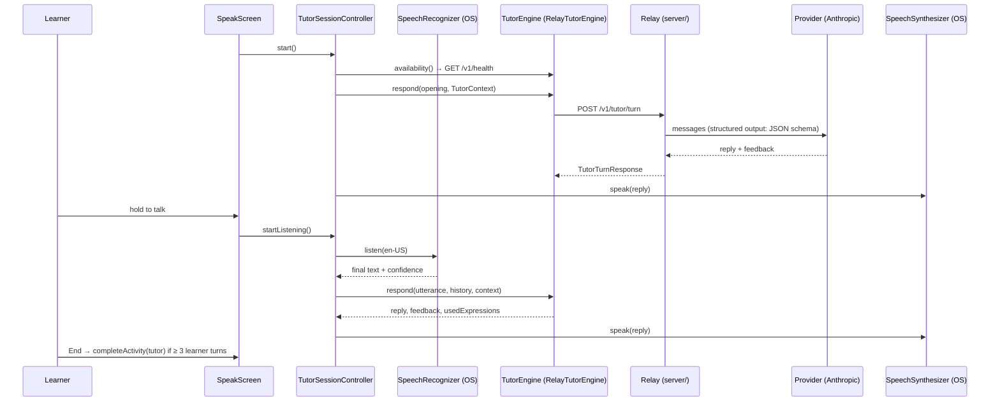

# AI Provider Integration: the Professor

## Status (2026-11-21)

| Part | State |
|---|---|
| Device contracts (`SpeechRecognizer`, `SpeechSynthesizer`, `TutorEngine`, `ExplanationProvider`) | ✅ implemented |
| On-device speech in (`speech_to_text`) and out (`flutter_tts`) | ✅ implemented for Android, iOS and web. Not available on Linux desktop. **Not yet verified on a physical phone** |
| `TutorSessionController`: state machine, feedback, XP after 3 or more learner turns, summary | ✅ implemented, unit- and widget-tested with test doubles |
| Relay `server/` (Node, `@anthropic-ai/sdk`), provider adapter, contract tests | ✅ implemented, 5 tests pass |
| **Live AI turn end to end** | ✅ **Verified 2026-11-21 with Addis AI** (`TUTOR_PROVIDER=addis`): opening and learner turns in Amharic and in Afaan Oromo, real roleplay replies, grammar feedback and native-language translations, about 2.7 s per turn. Evidence: `test/live/live_tutor_test.dart`, which drives the app's Dart client against the running relay. The Anthropic adapter is still unverified because the available key was rejected. |

Until a valid key is configured, the app shows *"The Professor is offline right now"* with an "Offline practice (not AI)" section. It never shows a scripted reply as if it were AI.

## Flow



## Contracts

**Domain request (`TutorRequest`):**
- `sessionId` and `characterId` (`professor`)
- `TutorContext`: native language, target language (en), `LearnerLevel`, content id and title, scene summary, transcript lines, focus expression, target expressions
- `history: List<TutorTurn>`
- `utterance`, where null means "open the conversation"
- `sttConfidence`

**Domain response (`TutorResponse`):**
- `replyText` and `replyTranslation`, which is AI-generated and labelled as such
- `feedback`: `kind` (great / grammar / wordChoice / pronunciation), `note`, `noteNative` and `suggestion`, which is the corrected sentence
- `suggestedExpression`, `usedExpressions` and `done`
- `speechUrl`, reserved for providers that render audio; it is null in the MVP

**Wire contract v1.** The full schemas are in `INTEGRATION_CONTRACTS.md` §7.
- `GET /v1/health` returns `{ok, provider, model, contract}`. It reports the configuration only and does not test the key.
- `POST /v1/tutor/turn` returns 200 with a response body, or `{error:{code,message}}`. The code is one of `unavailable` (503), `rate_limited` (429), `bad_request` (400/413) or `provider_error` (502).

**Provider adapters:**

- `server/src/providers/addis.mjs` is the **default** when `ADDIS_API_KEY` is set. It uses Addis AI `POST /api/v1/chat_generate` with `x-api-key`.
  - The native API ignores `system_prompt`, so the persona, scene, history and an output contract go into `prompt`.
  - The reply is a JSON object, which may come inside a code fence. It is parsed and validated, and anything unreadable becomes `provider_error`.
  - `target_language` is set to the learner's language.
- `server/src/providers/anthropic.mjs` is used when `TUTOR_PROVIDER=anthropic`:
- Calls `client.beta.messages.create` with structured JSON output (`output_config.format`) and `effort: "low"` to keep voice latency down.
- Enables server-side refusal fallbacks (`fallbacks: "default"`).
- Uses a 20 s timeout and 1 retry, and maps the SDK's typed errors to contract codes.
- Model: `TUTOR_MODEL`, default `claude-opus-5-5`. To trade quality for latency or cost, set `TUTOR_MODEL` to another current model after measuring.

**To add a provider:**
1. Write `server/src/providers/<name>.mjs`, exporting `{name, model, turn(req)}` that returns the response shape.
2. Select it in `server.mjs`.

The app needs no change. A device-side provider, such as an on-device model, would implement `TutorEngine` directly.

## Running it

```bash
cd server
cp .env.example .env              # TUTOR_PROVIDER=addis + ADDIS_API_KEY=... (git-ignored)
npm install && npm test && npm start   # listens on :8787
# app (phone on the same network as the relay):
flutter run --dart-define=TUTOR_BASE_URL=http://<laptop-ip>:8787
```

For production, put the relay behind HTTPS. Android blocks cleartext HTTP in release builds by default, so a local-network demo either uses a debug build or a TLS-terminated relay.

## Privacy

- Speech is recognised by the operating system's speech service. **The app never records audio to disk and never uploads audio.** Only recognised text goes to the relay.
  - Note: the platform recogniser itself may use the vendor's cloud. That is disclosed on the Speak intro screen as "speech is recognised on your phone"; this wording should be revisited per platform.
- The relay is stateless. It logs only timing and a truncated session id, never utterances or replies.
- Transcripts stay in memory for the session. After a session only a summary is kept (turn count, expressions used, suggestions), also in memory.
- No personal data, transcripts or audio are sent to analytics.

## Honesty rules (enforced in UI and tests)

- There is no scripted reply in production code paths. The test doubles live under `test/`.
- AI translations and notes carry an "AI translation" label.
- Curated, bundled explanations are `authoritative`. Any AI-generated explanation would be non-authoritative and labelled.
- Feedback on pronunciation is based on recognised text and confidence only. The app does not do phoneme-level scoring and does not claim to.
