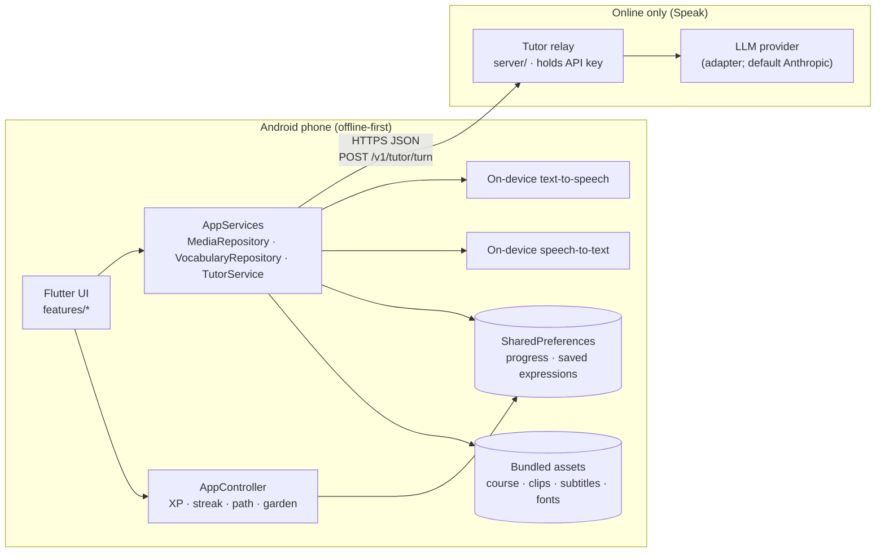

# Architecture

A single modular Flutter app with an optional tiny **tutor relay**. Everything on the core learning path is on-device. The only cloud dependency is the live AI tutor, and the relay exists only to keep credentials off the phone.

## System context



## Module boundaries

```
lib/
  app/                 SHARED: bootstrap, router (app.dart), AppController, AppScope, AppServices/ServicesScope
  core/                E1: theme tokens, motion, shared components
    navigation/        SHARED: AppRoutes, HomeTab, MediaLessonArgs (frozen contract)
  data/
    models/            SHARED: course, progress (existing) · media.dart, saved_expression.dart (new contracts)
    local/             E1: bundled course, ProgressStore
    repositories/      SHARED interfaces · E2 owns AssetMediaRepository behaviour
  services/
    tutor/             tutor_service.dart = SHARED contract · E3 adds live implementation files
  features/
    onboarding/ language_selection/ home/ learning_path/ lessons/
    word_garden/ achievements/ mascot/ my_words/             E1
    discover/ media_lesson/                                  E2
    speak/                                                   E3
assets/content/media/  E2: one folder per clip + index.json
server/                E3: tutor relay (optional, not bundled in the app)
```

**Rule:** features never import each other's internals. They talk through `AppRoutes` (navigation), `AppServices` (data/voice) and `AppController` (XP and progress).

## Frontend structure

- **State:** `AppController` (`ChangeNotifier`) via `AppScope` for learner progress. `VocabularyRepository` is a `ChangeNotifier` read via `ServicesScope`. Feature-local state stays in `StatefulWidget`s or a feature-local controller. No new state-management packages.
- **Navigation:** named routes in `lib/app/app.dart`, using the names in `AppRoutes`. Tabs live in `HomeShell` (E1).
- **Dependency injection:** `main.dart` builds `AppServices`. Tests use `AppServices.inMemory()` (the default in `LearningApp`).

## Backend requirements

Only the **tutor relay** (`server/`, owned by E3):

- One stateless endpoint `POST /v1/tutor/turn` plus `GET /v1/health` (`INTEGRATION_CONTRACTS.md` §7).
- It holds the provider API key in `server/.env`, which is git-ignored. The app never contains a provider key.
- It wraps the provider behind an adapter (`provider.anthropic`, possibly others), so the provider can be swapped.
- Hackathon deployment: it runs on a team laptop on the demo Wi-Fi or a free-tier host. The app reads its URL from `--dart-define=TUTOR_BASE_URL=…`. With no URL, the app uses `UnavailableTutorService`.

No database, no auth and no microservices.

## Service interfaces (code is the source of truth)

| Interface | File | Default impl | Owner |
|---|---|---|---|
| `ProgressStore` | `data/local/progress_store.dart` | `SharedPrefsProgressStore` | E1 |
| `MediaRepository` | `data/repositories/media_repository.dart` | `AssetMediaRepository` | E2 |
| `VocabularyRepository` | `data/repositories/vocabulary_repository.dart` | `SharedPrefsVocabularyRepository` | shared (E2 writes, E1 reads) |
| `TutorService` / `TutorSession` | `services/tutor/tutor_service.dart` | `UnavailableTutorService` → E3's live one | E3 |
| `AppController.recordActivity` | `app/app_controller.dart` | — | shared |

## Data flows

**Media lesson (offline):** `DiscoverScreen` → `MediaRepository.list()` → `AppRoutes.mediaLesson(MediaLessonArgs)` → the player's position drives `MediaItem.segmentAt(ms)` → subtitle + `Translations.of(native)` → tap an expression → sheet → `VocabularyRepository.save(SavedExpression.fromMedia(...))` → finish → `recordActivity(xp: 15)` → offer Speak with `TutorContext(sceneSummary, targetExpressions)`.

**Tutor turn (online):** hold the mic → `TutorState.listening` → on-device STT → `thinking` → relay `POST /v1/tutor/turn` → LLM → JSON reply → `speaking` (on-device TTS) + transcript + feedback → back to `idle`. After ≥ 3 learner turns, ending calls `recordActivity(xp: 20)`. Any failure → `error` with a retry option. No relay or network → `unavailable`.

## Why this shape

- **Six hours:** the existing app, patterns and tests are reused. New work is additive folders, so three engineers rarely touch the same file.
- **Offline-first:** the only network call is optional and isolated behind one interface.
- **Future-ready:** `Translations` is keyed by language code, media manifests are versioned, and the tutor is provider-agnostic with the character as data. Music, books, more languages and more characters can be added as content plus new adapters (`FUTURE_ROADMAP.md`).
