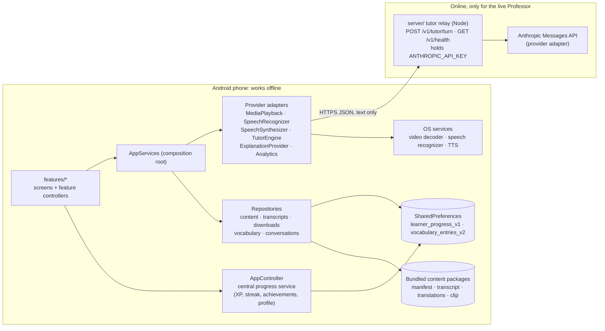

# Architecture

**Shape:** a modular monolith. It is one Flutter app with clear feature boundaries, plus one optional stateless **tutor relay** whose only job is to keep AI credentials off the phone. The core learning experience runs entirely on the device ([ADR 0001](ADR/0001-modular-monolith.md), [ADR 0002](ADR/0002-local-first-persistence.md)).

## System context

## Modules

The 11 conceptual modules map onto the existing folders. Nothing was moved just to match a template.

| Module | Where | Status |
|---|---|---|
| onboarding | `features/onboarding`, `features/language_selection` | ✅ welcome, native language, target language, English level |
| learner_preferences | `LearnerProfile` (in `data/models/progress.dart`), `AppController.chooseLanguages/setNativeLanguage/setLevel` | ✅ persisted |
| learn | `features/home`, `features/learning_path`, `features/lessons`, `features/word_garden` | ✅ milestone 1, plus the new dashboard |
| discover | `features/discover` | ✅ catalogue from `LearningContentRepository` |
| media_learning | `features/media_lesson` (controller + screen + expression sheet) | ✅ |
| vocabulary | `features/my_words`, `data/repositories/vocabulary_repository.dart` | ✅ |
| revision | `features/revision` | ✅ flashcards with fixed review intervals |
| tutor | `features/speak` (controller + screen), `services/tutor`, `services/speech`, `server/` | ⚠️ pipeline built and tested; a live AI turn still needs a valid key on the relay |
| progress | `app/app_controller.dart`, `data/models/activity.dart`, `features/progress` | ✅ the single XP mechanism |
| offline_content | `assets/content/`, `content_repository.dart` (bundled implementations) | ✅ bundled; downloads are an interface only |
| profile | `LearnerProfile` | ⏳ read model only; no profile screen |

Layering inside a feature:

- **presentation:** `*_screen.dart` and widgets. They hold no business rules.
- **application:** `*_controller.dart`, which orchestrates repositories, providers and progress.
- **domain:** `data/models/*`, pure Dart with no Flutter imports, except `language.dart` for `TextDirection`.
- **data:** `data/repositories/*` holds the interfaces and their local implementations.

## Rules (enforced by `test/unit/architecture_test.dart` and `test/widget/offline_test.dart`)

1. `lib/features/**` never imports `http`, `speech_to_text`, `flutter_tts` or `video_player`. It goes through `lib/services` interfaces.
2. Features never import a concrete tutor provider (`relay_tutor_engine.dart`). Only `main.dart` wires it.
3. Domain models (`TranscriptSegment`, `Expression`, `VocabularyEntry`, …) are never declared in `lib/features`.
4. XP, streak and completed activities change **only** in `AppController`.
5. Network APIs appear in exactly one file: `lib/services/tutor/relay_tutor_engine.dart`.
6. No secrets exist in `lib/`, `assets/content/`, `server/src/` or `android/app/src/`.
7. Amharic and Oromo UI strings live in `core/l10n/app_strings.dart`. Milestone-1 exceptions are listed explicitly, so this debt cannot grow silently.

## Repository interfaces

| Interface | MVP implementation | Future implementation |
|---|---|---|
| `LearningContentRepository` | `BundledContentRepository` (assets, rights-gated) | remote catalogue + cache |
| `TranscriptRepository` | `BundledTranscriptRepository` (source + `translations/<code>.json`) | downloaded packs, CDN |
| `DownloadRepository` | `BundledDownloadRepository` (everything bundled) | download manager |
| `VocabularyRepository` | `SharedPrefsVocabularyRepository` | SQLite/Drift + sync outbox |
| `ProgressStore` (the progress repository) | `SharedPrefsProgressStore` | SQLite + sync |
| `ConversationRepository` | `InMemoryConversationRepository` (summaries only) | opt-in persistence |

All of these are injected through `AppServices`, which `main.dart` builds. Tests use `AppServices.inMemory(...)`. No dependency-injection package is used.

## Extension points

| Future capability | Plug-in point |
|---|---|
| Music with synced lyrics, audio stories, podcasts | `ContentType` + `MediaPlayback` (audio implementation) + the same `Transcript`/`spansFor` logic |
| Books and articles | `ContentType.book/article` + a reader widget. `Expression` and `Translations` are reused |
| New Ethiopian languages | add `LanguageInfo` + `translations/<code>.json` + `AppStrings` entries ([ADR 0005](ADR/0005-translation-vs-ui-localization.md)) |
| More AI characters | the `characterId` field in `TutorRequest`. Personas are relay-side data |
| Another AI or speech provider | implement `TutorEngine` / `SpeechRecognizer` / `SpeechSynthesizer`, then wire it in `main.dart` |
| Accounts and sync | remote repository implementations. Entries already carry local UUIDs, `updatedAt` and `dirty` |
| Analytics | implement `Analytics`. Events are already emitted |

## Backend

The only backend is `server/`, the tutor relay ([AI_PROVIDER_INTEGRATION.md](AI_PROVIDER_INTEGRATION.md)). Future API contracts are drafted in [INTEGRATION_CONTRACTS.md §10](INTEGRATION_CONTRACTS.md); none of them are implemented.

## Performance notes for low-end Android

- One `VideoPlayerController` exists per lesson. The controller disposes it, and its listener is removed before `dispose`.
- Subtitle lookup is a binary search on each position tick, and the UI rebuilds only when the segment changes.
- `TapGestureRecognizer`s for expressions are disposed on every rebuild and on unmount.
- Repositories cache parsed content and return `SynchronousFuture`, so there is no loading flash on revisit.
- Speech plugins are created lazily, so no platform channel opens until Speak is used.
- The bundled clip is 170 KB (H.264 baseline, 640×360, 15 fps). The whole content pack is 224 KB.
