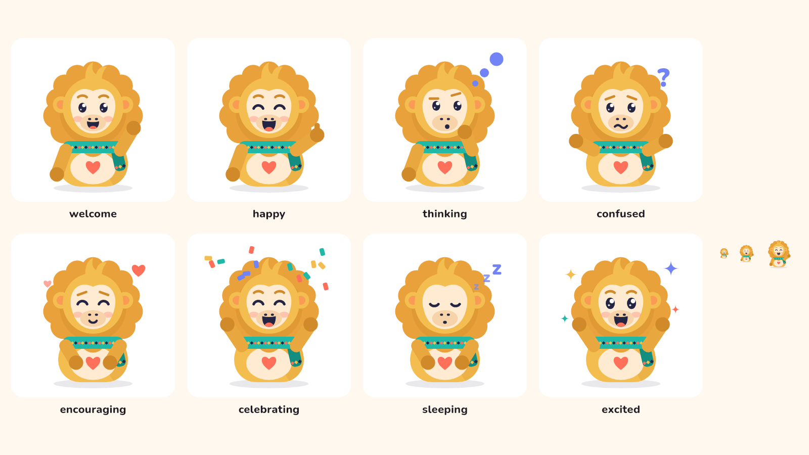

# Mascot & Character System

> Status: **working concept**. Name, final proportions and production animation are not final.
> Implemented as a vector `CustomPainter` in `lib/features/mascot/` (no image or Rive assets required).

## 1. Name placeholder

**"Gela"** (placeholder, from *gelada*). Kept in one constant, `AppConfig.mascotName`, so it can be renamed without touching the UI.

## 2. Concept

The mascot is a **gelada-inspired companion**. Geladas live only in the Ethiopian highlands. They have one of the richest vocal repertoires of any non-human primate, which suits a character about communication. They are also known for the bright heart-shaped patch on their chest.

Gela takes three things from that:

| Real-world trait | Design translation | Meaning in the product |
|---|---|---|
| Lion-like mane cape | Big scalloped golden mane: the main silhouette | Warmth, confidence, instantly recognisable at 24 px |
| "Bleeding-heart" chest patch | Coral heart on an ivory belly | Learning with heart; mistakes are safe |
| Highly vocal, social species | Paired with speech bubbles throughout the UI | Communication and connection between cultures |

Cultural layer: Gela wears a **teal scarf with a *tibeb*-style woven border**, the patterned edge of Ethiopian handwoven cloth. The pattern is used in the UI as well (the `TibebBand` component), but sparingly, as a signature rather than decoration.

**Originality:** Gela is a primate with a mane, heart patch and scarf, drawn with soft rounded geometry. It shares no anatomy, colour scheme or pose language with Duolingo's owl or with any other existing mascot.

## 3. Personality

- **Curious.** Asks questions with you instead of quizzing you.
- **Warm and patient.** Responds to a mistake with a hug, never a frown.
- **Proud of you.** Celebrates loudly, with arms up and confetti.
- **A little cheeky.** Uses the raised eyebrow and the sideways glance when thinking.

Voice: short and friendly, greets in the learner's own language (ሰላም! / Akkam!).

## 4. Visual characteristics

- Built on a 200×200 design grid and scaled to any size.
- Silhouette: scalloped mane halo, hair tuft on top, a rounded "bean" body and a soft ground shadow.
- Pale heart-shaped face mask and a short rounded muzzle with two nostrils.
- Large dark oval eyes with two highlights. Expression comes mostly from eyes, brows and arms.
- Arms are rounded capsules with darker hands. Poses: rest, wave, both up, hand to chin, shrug, thumb up, hug.

## 5. Main colours

| Part | Colour |
|---|---|
| Mane | `#E9A23B`, shading `#D08A2A` |
| Fur / body / arms | Golden yellow `#F4BD50` |
| Face mask, belly | Warm cream `#FFEBD2` |
| Muzzle | `#F7D3AA` |
| Eyes, nose, mouth | Midnight indigo `#242443` |
| Heart patch, tongue, blush | Coral `#FF705B` |
| Scarf | Teal `#20B8A6`, tail `#138E80`, tibeb diamonds in coral / gold / indigo |
| Props (thought dots, ?, zzz, sparkles) | Periwinkle `#7183F5` + palette |

## 6. Expressions (all implemented: `MascotMood`)

| Mood | Eyes / brows / mouth | Arms | Prop | Used on |
|---|---|---|---|---|
| `welcome` | open, raised brows, grin | wave | — | Welcome screen, new learner's home |
| `happy` | smiling arcs, open mouth | thumb up | — | Correct answer, language chosen |
| `thinking` | glance aside, one brow up, small "o" | hand to chin | thought dots | While answering, language prompt |
| `confused` | open, worried brows, wavy mouth | shrug | "?" | After a wrong answer (prompt area), missing content |
| `encouraging` | soft smile arcs, worried brows | hug | hearts | Incorrect-answer panel, quit sheet, streak reminder |
| `celebrating` | smiling arcs, open mouth | both up | confetti | Lesson complete, all content finished |
| `sleeping` | closed, no brows, tiny mouth | hug | "zzz" | Empty Word Garden |
| `excited` | wide sparkly eyes, open mouth | both up | sparkles | Current path node, badge or level-up on completion |

## 7. Animation (what is actually implemented)

Implemented in Flutter and tested (`test/widget/motion_test.dart`):

- **Idle loop** (2.6 s): breathing (body and mane), a periodic blink, a waving arm for `welcome`, a bounce for arms-up moods, floating props.
- **Expression transitions:** cross-fade plus a small pop (`AnimatedSwitcher`, ease-out-back).
- **Reduced motion:** when the OS asks for reduced or removed animations, the idle loop stops and transitions become instant.
- Each mascot is wrapped in a `RepaintBoundary` so its idle motion does not repaint the screen around it.

Opportunities for production animation (not implemented):

- A Rive state machine with blend trees for walking, a head-tilt "listening" pose and lip-sync for future audio prompts.
- Reactions to streak milestones (a flame torch), to Word Garden blooms (watering can) and to checkpoints (flag plant).
- Squash-and-stretch on taps.

## 8. Supporting characters (ideas only, not implemented)

| Character | Concept | Role |
|---|---|---|
| **Walia** (placeholder) | Young Walia ibex with big curled horns | Checkpoint and challenge guide; "climbs" with you |
| **Buna** (placeholder) | Small round *jebena* (clay coffee pot) spirit | Host of conversation and dialogue lessons (coffee ceremony = conversation) |
| **Kokeb** (placeholder) | Tiny star-bird | Daily quests and streak reminders |
| **Abeba** (placeholder) | Meskel-daisy sprite | Word Garden caretaker |

## 9. Production notes

- All moods render at 24, 40, 64, 160 and 300 px (`test/screenshots/mascot_sheet_test.dart`).
- Replacing the painter with Rive later only requires changing `Mascot`. Every screen uses `Mascot(mood: …)`.
- Do not use emoji as a stand-in for the mascot anywhere.
